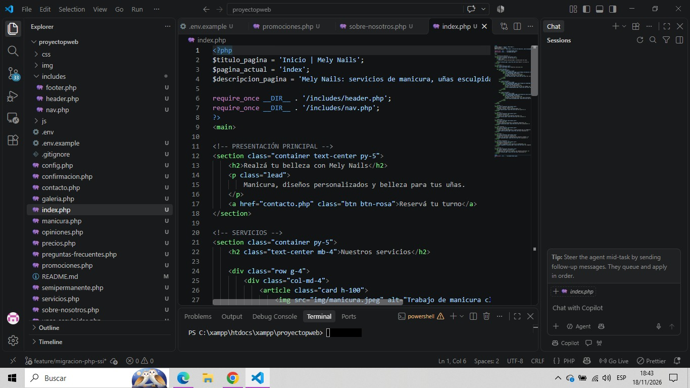

Mely Nails 💅

Descripción del proyecto

Mely Nails es un sitio web desarrollado para un emprendimiento dedicado a los servicios de manicura y diseño de uñas.

El objetivo es dar a conocer el emprendimiento, mostrar los servicios disponibles y facilitar el contacto con las personas interesadas en solicitar un turno.

El proyecto comenzó con HTML, CSS y JavaScript, y posteriormente fue migrado a PHP para incorporar modularización, reutilización de componentes y renderizado del lado del servidor (SSR).

Tecnologías utilizadas

- HTML5
- CSS3
- Bootstrap 5
- JavaScript
- PHP 8.x
- XAMPP
- Git y GitHub
- Figma (diseño y wireframes)

Estructura del proyecto

- "index.php": página principal.
- "servicios.php": información sobre los servicios.
- "manicura.php": servicio de manicura clásica.
- "semipermanente.php": servicio de esmaltado semipermanente.
- "unas-esculpidas.php": servicio de uñas esculpidas.
- "galeria.php": galería de trabajos.
- "precios.php": información sobre precios.
- "promociones.php": promociones disponibles.
- "sobre-nosotros.php": información del emprendimiento.
- "opiniones.php": opiniones de clientes.
- "preguntas-frecuentes.php": preguntas frecuentes.
- "contacto.php": formulario de contacto.
- "confirmacion.php": mensaje de confirmación.
- "includes/": contiene los componentes compartidos del sitio.
  - "header.php": encabezado y metadatos.
  - "nav.php": menú de navegación.
  - "footer.php": pie de página y archivos JavaScript.
- "config.php": configuración de variables de entorno.
- ".env": variables de configuración locales.
- ".env.example": plantilla de configuración.
- "css/": hojas de estilo.
- "js/": archivos JavaScript.
- "img/": imágenes del sitio.

Modularización (SSI)

Se implementó la modularización mediante archivos PHP compartidos utilizando "require_once".

Los componentes comunes del sitio se separaron en tres archivos:

- "header.php"
- "nav.php"
- "footer.php"

Esto permite reutilizar el código en todas las páginas y facilita su mantenimiento y actualización.

Renderizado del lado del servidor (SSR)

Se incorporaron variables PHP para generar títulos y descripciones dinámicas en cada página.

También se implementó la identificación automática de la página actual para mostrar el elemento activo en el menú de navegación.

Variables de entorno

Se creó un sistema de configuración mediante los archivos ".env", ".env.example" y "config.php".

Las variables utilizadas son:

- "APP_NAME": nombre del emprendimiento.
- "SUPPORT_EMAIL": correo electrónico de contacto.
- "APP_ENV": entorno de ejecución.

El archivo ".env" está excluido del repositorio mediante ".gitignore" para proteger los datos de configuración personales.

Diseño en Figma

"Ver diseño y wireframes en Figma" (https://www.figma.com/design/RLMpepukivLeEbV8fChFHw/Untitled?node-id=0-1&t=6PWvYZjJNtCqQijX-1)

Instalación y ejecución local

1. Instalar XAMPP.

2. Iniciar los servicios Apache.

3. Copiar el proyecto dentro de la carpeta "htdocs".

4. Crear el archivo ".env" tomando como referencia ".env.example".

5. Configurar las variables de entorno.

6. Abrir el navegador y acceder a:
   
   "http://localhost/xampp/proyectopweb/"

Se requiere PHP 8.x para ejecutar el proyecto.

Objetivo académico

Este proyecto forma parte de los trabajos prácticos de la materia Programación Web y tiene como finalidad aplicar conocimientos de maquetación web, HTML semántico, estilos, accesibilidad, PHP, modularización, renderizado del lado del servidor, variables de entorno y control de versiones con Git y GitHub.

Autoría

Proyecto académico desarrollado para el emprendimiento Mely Nails.
## Capturas de pantalla

### 1. Sitio funcionando en XAMPP
## Capturas de pantalla

### 1. Sitio funcionando en XAMPP

### 2. Modularización SSI

### 3. Renderizado del lado del servidor (SSR)

### 4. Variables de entorno

